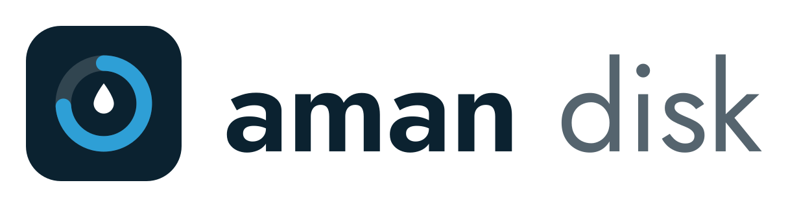
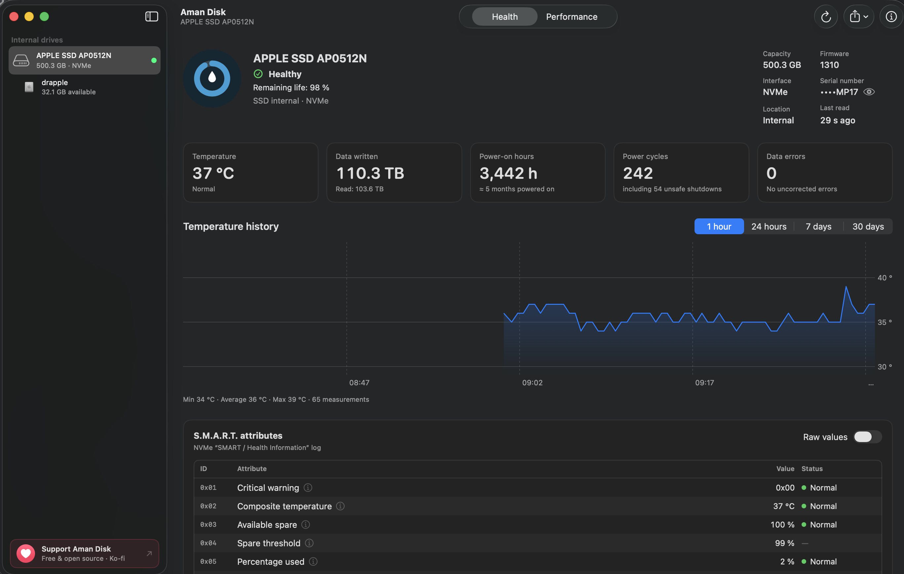
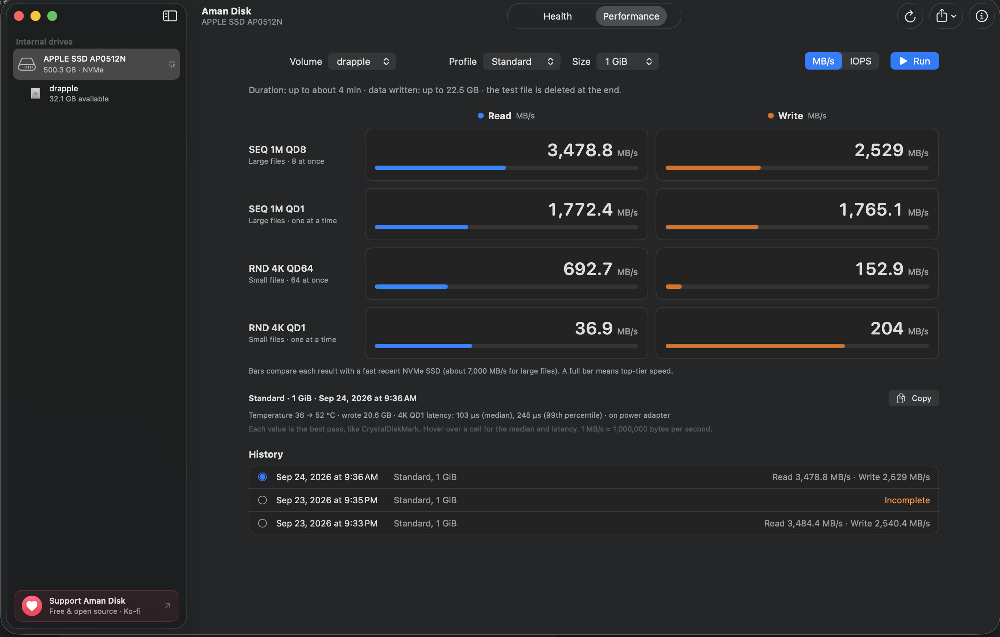
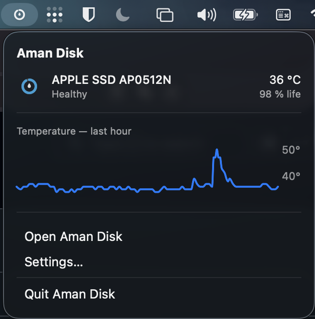

<p align="center">
  <picture>
    <source media="(prefers-color-scheme: dark)" srcset="Branding/Aman-Disk-brand/logo/aman-disk-logo-dark.svg">
    <source media="(prefers-color-scheme: light)" srcset="Branding/Aman-Disk-brand/logo/aman-disk-logo-light.svg">
    
  </picture>
</p>

<p align="center"><b>Health, temperature and performance of your Mac's internal and external drives, explained in plain language.</b><br>
Native macOS app for Apple Silicon and Intel Macs · Universal binary · Completely offline and private.</p>

<p align="center">
  <a href="https://github.com/MidZai/aman_disk/releases/latest">
    
  </a>
  &nbsp;
  <a href="https://ko-fi.com/midzai">
    
  </a>
</p>

<p align="center">
  <sub>Free and open source · macOS 14 or later · Apple Silicon and Intel · <a href="https://github.com/MidZai/aman_disk/releases/latest">Latest version</a> · <a href="https://midzai.github.io/aman_check/">Website</a> · Sister project: <a href="https://github.com/MidZai/aman_check">Aman Check</a>, a condition report for used Macs</sub>
</p>

<p align="center">
  
</p>

## Screenshots

| Performance test | Menu bar |
|---|---|
|  |  |

## Features

- **Internal & external drive health**: reads S.M.A.R.T. data from internal NVMe SSDs, Apple PCIe AHCI SSDs, SATA drives, external Thunderbolt/USB4 NVMe SSDs, and external USB SATA enclosures (via open-source SAT SMART Driver), with a clear status (“Healthy”, “Needs attention”, “Likely failing”) and remaining life when reported.
- **Hardware details without S.M.A.R.T.**: for USB drives where macOS restricts S.M.A.R.T. access, displays bridge chip vendor, USB link speed, transport protocol (UAS / BOT), volumes, and a calm, non-alarming explanation.
- **Attributes explained**: every S.M.A.R.T. attribute has a readable name and an explanation; values are converted to their unit (°C, hours, TB), or shown as raw hexadecimal on request.
- **Continuous temperature history**: one reading every 30 seconds, kept at full resolution for 24 hours, then as 5-minute averages for 30 days. External drives regain their history upon reconnection via SHA-256 fingerprint hashing.
- **Performance benchmark**: sequential and random reads and writes for internal and external drives, with live link throughput comparisons (e.g. USB 5 Gb/s vs Thunderbolt). The test file is always cleanly removed, even on mid-test disconnection.
- **Menu bar**: status and temperature of internal and connected external drives separated by a clean divider, with the last hour's curve.
- **Live Dock icon**: the ring around the icon follows the health of the startup boot drive.
- **Alerts**: notifications when a readable drive changes status, stays too hot, or drops below 50%, 25% or 10% of its life (disabled by default; zero false alerts on hot-unplug).
- **Reports**: PDF, text or JSON export, and anonymized hardware compatibility reports, with serial numbers masked by default.
- **Multilingual interface**: available in 18 languages (English, Français, 简体中文, 繁體中文, 한국어, 日本語, Deutsch, Español, Português do Brasil, Русский, العربية with full RTL layout, Italiano, Nederlands, Polski, Türkçe, हिन्दी, Tiếng Việt, Українська). See [docs/TRANSLATING.md](docs/TRANSLATING.md) to contribute or review translations.

## Privacy

- **No network connection**: Aman Disk never connects to the Internet. No telemetry, no update check. The only links (GitHub, including “Check for New Versions…”, and Ko-fi) open in your browser when you click them.
- **No data sent**: history and results stay on your Mac, in `~/Library/Application Support/io.github.aman-disk.AmanDisk/`.
- **Aman never changes your data.** One exception: it turns on S.M.A.R.T. if it's turned off (you can disable this in Settings). The app never asks for an administrator password. The performance test, which you start yourself, writes a temporary file that is deleted afterwards, even if the app is force-quit.

## Installation

1. Download the DMG (`Aman-Disk-<version>.dmg`) from the [latest release](https://github.com/MidZai/aman_disk/releases/latest).
2. Open it and drag **Aman Disk** into the **Applications** folder.
3. Open Aman Disk. The first time, macOS blocks it: follow the steps below. You only need to do this once.
4. When an external drive is plugged in, macOS asks whether Aman Disk may access **removable volumes**. Allow it: that permission is how the app sees external drives. It still only reads.

### macOS says Aman Disk can't be opened

Aman Disk is free and open source, but it isn't signed with a paid Apple Developer ID, so macOS can't verify who made it and blocks it the first time. The source code is all here, and you can [build the app yourself](#build-from-source).

**macOS 15 Sequoia or later**

1. Open Aman Disk, then click **Done** in the warning.
2. Go to **System Settings › Privacy & Security** and scroll down to **Security**.
3. Next to “Aman Disk was blocked to protect your Mac”, click **Open Anyway**, then confirm with your password or Touch ID.

If the **Open Anyway** button isn't there, open Aman Disk once more, then go back to System Settings.

**macOS 14 Sonoma**: in the **Applications** folder, Control-click **Aman Disk**, choose **Open**, then click **Open**.

**Or, in Terminal** (any version), remove the download flag that macOS checks:

```bash
xattr -dr com.apple.quarantine "/Applications/Aman Disk.app"
```

The DMG contains the same steps in **How to Install.txt**.

### Build from source

```bash
scripts/bundle.sh --release   # Aman Disk.app, universal binary
scripts/make-dmg.sh           # dist/Aman-Disk-<version>.dmg
scripts/test.sh               # full test suite (also works without Xcode)
```

Demo mode (`DISKHEALTH_DEMO=1`) shows fictional drives in every state.

## Compatibility

- **macOS 14 Sonoma** or later.
- **Apple Silicon** and **Intel** Macs (universal binary).
- **Internal drives**:
  - Apple Silicon internal NVMe SSDs (Apple Fabric).
  - Intel Mac internal NVMe and PCIe AHCI SSDs.
  - Internal SATA SSDs and hard disks, including Apple Fusion Drive.
- **External Thunderbolt & USB4 drives**:
  - Full native NVMe S.M.A.R.T. reading, health assessment, temperature monitoring, and performance benchmarking on Thunderbolt 3/4/5 and USB4 (PCIe mode) enclosures (OWC, Acasis, Trebleet, Sabrent, etc.).
- **External USB SATA drives with SAT SMART Driver**:
  - Reads ATA S.M.A.R.T. health, attributes, and temperatures when the user installs the open-source third-party SAT SMART Driver kernel extension.
- **External USB drives without driver**:
  - Bridge chip controller identification (JMicron, ASMedia, Realtek, etc.), link speed (USB 3.2 10 Gb/s, USB 3.0 5 Gb/s, USB 2.0), transport protocol (UAS / BOT), volumes, partition formats, and performance benchmarks.
  - See the [Hardware Compatibility Guide](docs/COMPATIBILITY.md) for tested enclosures and community reports.

## Future Roadmap (post-1.0)

- **DriverKit Extension (DEXT)**: modern user-space DriverKit driver without requiring “Reduced Security” mode on Apple Silicon, enabling S.M.A.R.T. reading across USB enclosures without legacy kernel extensions.
- **USB NVMe bridge support**: vendor-specific passthrough commands (Realtek RTL9210, JMicron JMS583, ASMedia ASM2362) via the DriverKit driver.
- **Apple Developer ID & Notarization**: signed and notarized binaries to eliminate macOS Gatekeeper first-launch security prompts.
- **Desktop & Lock Screen Widgets**: WidgetKit widgets displaying drive temperature and health rings directly on your macOS desktop.

## Why “Aman”?

The name has three meanings, and all of them fit an app that watches over your drives:

- In **Kabyle**, *aman* means water, hence the drop at the center of the icon. The ring around it is also ⴰ, the letter A of the Tifinagh alphabet.
- In **Tolkien**'s world, Aman is the Blessed Realm, the land in the far West where the Valar live. It is Gandalf's original home: before coming to Middle-earth, he lived there as Olórin, in the gardens of Lórien in Valinor.
- In **Arabic**, *amān* (أمان) means safety and security, and also peace of mind: the calm of knowing you are protected.

## Support the project

Aman Disk is free and open source. If you find it useful, you can support its development on Ko-fi.

<a href="https://ko-fi.com/midzai"></a>

## License

[MIT](LICENSE) © 2026 MidZai
